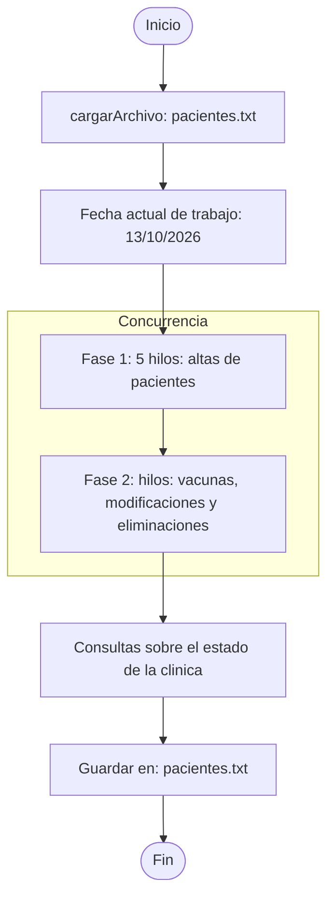
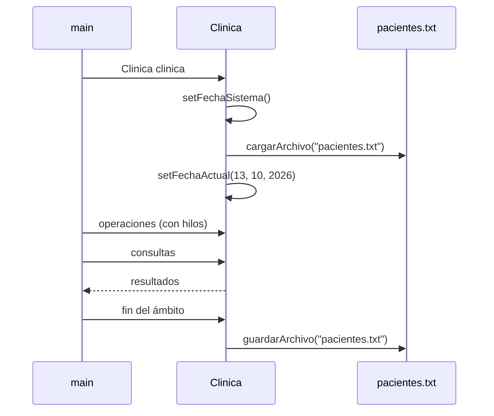

# Práctica 4 — Clínica de Vacunación (Programación Concurrente y Paralela)

## Descripción general

Este programa simula el flujo de una **clínica de medicina general** dedicada a la
información de pacientes pediátricos. Los datos se guardan en un **archivo de texto**
(`pacientes.txt`) y el programa permite registrar pacientes, registrar aplicaciones de
vacunas, agendar vacunas, modificar o eliminar información, y realizar consultas
(buscar, contar, rangos de edad, próximas vacunas, etc.).

## Diagrama general del funcionamiento (nivel conceptual)

**Flujo resumido:**

1. **Carga**: el constructor de `Clinica` lee `pacientes.txt` y toma la fecha actual.
2. **Trabajo**: se crean varios `std::thread` (con un solo `std::mutex` global por clínica).
3. **Consultas**: sobre el estado ya modificado.
4. **Persistencia**: el destructor de `Clinica` vuelve a escribir `pacientes.txt`.

## Componentes del programa

| Archivo | Responsabilidad |
|---|---|
| `main.cpp` | Orquesta el demo: crea los hilos, ejecuta las fases, llama a las consultas. |
| `clinica.h/.cpp` | Clase `Clinica`: contiene el `vector<Paciente>` y todas las operaciones. |
| `paciente.h/.cpp` | Clase `Paciente`: id, nombre, fecha de nacimiento y listas de vacunas. |
| `vacuna.h/.cpp` | Clase `Vacuna`: nombre + fecha de aplicación. |
| `fecha.h/.cpp` | Validación de fechas, diferencias en días, edad, mismo mes. |
| `utils.h/.cpp` | Utilidades: mayúsculas/minúsculas, comparación, búsqueda binaria. |
| `pacientes.txt` | Archivo de persistencia con los pacientes. |

## Ciclo de vida de la instancia `Clinica`

## Concurrencia

- Todas las operaciones sobre el vector de pacientes están protegidas por
  `std::mutex mtx` usando `std::lock_guard<std::mutex>`.
- Una sola instancia de `Clinica` es compartida por los hilos.
- Se inserta en orden por `id` para que la **búsqueda binaria** siempre sea válida.
- La salida por consola se protege con otro mutex (`g_out`) para que los mensajes de los
  hilos no se mezclen.

## Persistencia

- El **constructor** carga el archivo.
- El **destructor** guarda los cambios.
- Formato de cada línea: `Nombre; dd/mm/aaaa; vacunas recibidas; vacunas proximas`.

## Consultas implementadas

- Búsqueda por id, nombre y fecha de nacimiento.
- Mostrar información de un paciente.
- Nombres alfabéticos.
- Rango de edades.
- Pacientes con vacuna próxima en 7 días.
- Conteo de vacunas aplicadas en la última semana.
- Conteo de una vacuna próxima (siguiente mes).
- Pacientes vacunados en el mes actual.
- Mostrar pacientes de 5 en 5 (`mostrarTodo5en5`).
