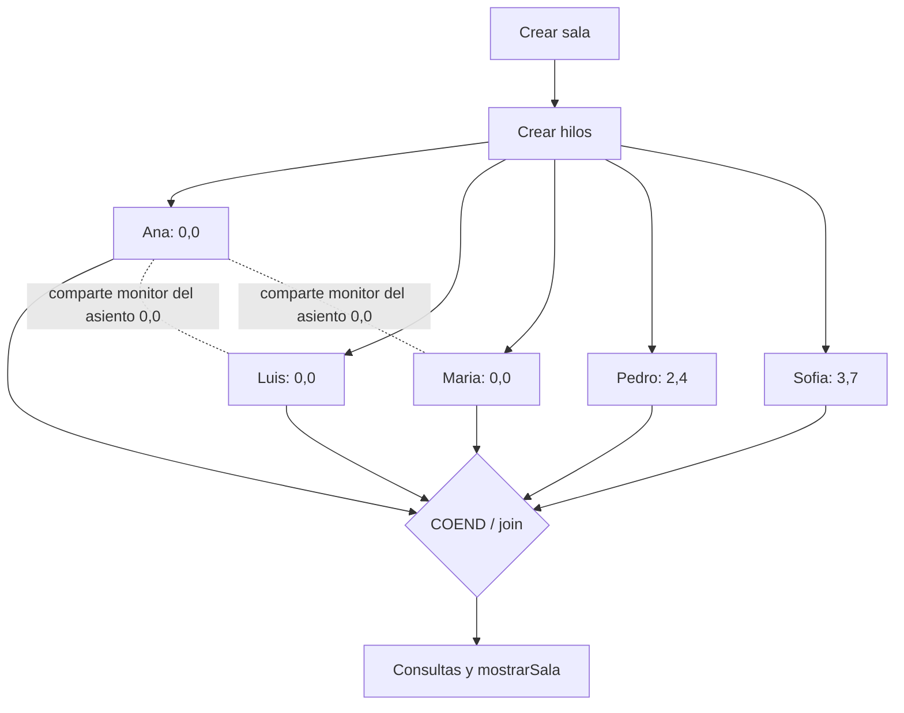

# Guía de estudio — Práctica 5: reserva concurrente de asientos

Material para que todo el equipo entienda **por qué está hecho así** y pueda
explicarlo en clase. No es el reporte formal: es una guía de estudio.

---

## 1. De dónde venimos: el error de la práctica 4

En la práctica 4 teníamos **un solo `std::mutex`** en `Clinica` y lo tomábamos
en *todos* los métodos, incluso en los que solo leían (`buscarPorId`,
`buscarPorNombre`, contar, imprimir...). Consecuencias:

- Dos lectores se bloqueaban entre sí, aunque no podían corromper nada.
- Dos escrituras sobre **pacientes distintos** también se bloqueaban.
- Hacíamos E/S por consola (e incluso `cin.get()` esperando a una persona)
  con el cerrojo tomado.

Resultado: los hilos existían, pero su trabajo ocurría **de uno en uno**. Por eso
nos penalizaron. La conclusión no es "quitemos la sincronización", sino:

> La sincronización es necesaria, pero hay que elegir bien **qué** se protege y
> **cuánto** se protege. Eso se llama *granularidad*.

---

## 2. La idea central: ¿cuál es la sección crítica?

Una **sección crítica** es el fragmento de código que no pueden ejecutar dos
hilos a la vez porque tocan datos compartidos.

| Diseño | Sección crítica | Reservar (0,0) y (2,4) | Veredicto |
|---|---|---|---|
| Un mutex global | Toda la sala | Secuencial | ❌ penalizado |
| `ReentrantReadWriteLock` global | Toda la sala (lectura compartida, escritura exclusiva) | Secuencial entre escritores | ⚠️ mejor, pero insuficiente |
| Cerrojo por asiento | **Cada asiento** | Concurrente | ✅ solución final |

En la sala, el dato compartido no es "la sala entera": es **cada asiento**. Si
Ana reserva (0,0) y Pedro reserva (2,4), no están tocando el mismo dato, así que
no hay motivo para que se esperen. Solo Ana, Luis y María —que quieren (0,0)—
comparten sección crítica y deben serializarse.

---

## 3. El mecanismo: `synchronized` y el monitor

Todo objeto Java trae consigo un **cerrojo interno** llamado *monitor*. La
palabra `synchronized` en un método de instancia lo activa y bloquea `this`:

```java
public synchronized boolean ocupar(Persona persona) { ... }
```

Cuando un hilo entra a ese método de un asiento:

1. Toma el monitor **de ese asiento**. Otros hilos que quieran *ese mismo*
   asiento se quedan esperando; los que quieran otros asientos siguen libres.
2. Hace "revisar si está libre + ocuparlo" como una sola operación **atómica**.
   Sin esto, dos hilos podrían ver "libre" al mismo tiempo y los dos escribir.
3. Al salir del método, el monitor se libera **automáticamente**, aunque haya
   un `return` o una excepción (no hace falta `try/finally`).
4. Quien entra después **ve** los cambios de quien salió: `synchronized` también
   da visibilidad (barrera de memoria), no solo exclusión mutua.

¿Y `volatile`? No sirve aquí: da visibilidad, pero **no** hace atómico el par
"revisar y ocupar". Por eso se usa `synchronized`.

---

## 4. Mapa del código

| Archivo | Responsabilidad | Puntos clave |
|---|---|---|
| `Asiento.java` | Guarda si está libre o quién lo ocupa | Los 5 métodos públicos son `synchronized`. Toda la sincronización vive aquí. |
| `Sala.java` | Matriz de asientos y consultas | **No tiene ningún cerrojo.** `asientos` es `final` y se llena por completo en el constructor. Los métodos validan rango y delegan en un solo asiento. |
| `Persona.java` | Datos de la persona | `final`, campos `final`, sin setters: es inmutable y se puede compartir entre hilos sin más cerrojos. |
| `Main.java` | Demostrador | Crea 5 hilos: tres pelean (0,0) y dos van a (2,4) y (3,7). |
| `Ubicacion.java` | Coordenada `(fila, columna)` | `record`, inmutable. |
| `PruebaConcurrencia.java` | Verificación | Dos pruebas de estrés (sección 7). |

---

## 5. Recorrido del demostrador (`Main.java`)

| Instante | Hilo | Acción | Resultado |
|---|---|---|---|
| 1 | Ana | `asignarAsiento(0,0)` | Toma el monitor de (0,0) → gana |
| 2 | Luis | `asignarAsiento(0,0)` | Espera el monitor de (0,0) → ve ocupado → `[X]` |
| 3 | María | `asignarAsiento(0,0)` | Igual → `[X]` |
| 4 | Pedro | `asignarAsiento(2,4)` | Monitor distinto → **entra al mismo tiempo** → `[OK]` |
| 5 | Sofía | `asignarAsiento(3,7)` | Otro monitor → **también en paralelo** → `[OK]` |

Después del `join` se liberan asientos y se hacen consultas. El ganador de (0,0)
cambia en cada ejecución: eso es evidencia de concurrencia real, no un error.

### Bloques COBEGIN – COEND

```
INICIO
    sala <- crear sala de 8 x 10

    COBEGIN
        Ana   -> reservar (0,0)
        Luis  -> reservar (0,0)
        María -> reservar (0,0)
        Pedro -> reservar (2,4)
        Sofía -> reservar (3,7)
    COEND

    liberar (2,4)
    COBEGIN
        buscarPorAsiento(0,0)
        buscarPorNombre("Sofia")
        asientosOcupados()
    COEND

    mostrarSala()
FIN
```

### Grafo de dependencias (versión simple)



Las líneas punteadas no son dependencias de ejecución: solo indican qué hilos
compiten por el **mismo** cerrojo. Pedro y Sofía no tienen ninguna.

---

## 6. Cómo compilar, ejecutar y probar

```bash
cd programa
bash run.sh                                   # demo + compilación
javac -d out ./*.java && java -cp out PruebaConcurrencia   # pruebas
```

`run.sh` borra `out/`, compila todos los `.java` y ejecuta `Main`.

---

## 7. Qué verifican las pruebas

1. **Mismo asiento:** 50 rondas × 200 hilos compitiendo por (0,0). Siempre gana
   exactamente uno. Comprueba que `synchronized` hace atómico "revisar y ocupar"
   y que nadie puede liberar un asiento libre.
2. **Asientos distintos:** 80 hilos reservan los 80 asientos de la sala y los 80
   logran reservar. Comprueba que no hay cerrojo global que los serialice.

---

## 8. Preguntas típicas y respuestas cortas

**¿Por qué no usamos un mutex en `Sala` como en la práctica 4?**
Porque serializaría a todos los hilos. Aquí cada asiento se protege solo, así que
operaciones sobre asientos distintos avanzan en paralelo.

**¿Entonces no hay sección crítica?**
Sí la hay, pero es **por asiento**, no por sala. Cada `synchronized` define una
sección crítica pequeña e independiente.

**¿Por qué `Persona` es inmutable?**
Para que una vez guardada en un asiento, otro hilo pueda leerla sin peligro de
que alguien la esté modificando al mismo tiempo.

**¿Por qué `mostrarSala` copia antes de imprimir?**
Imprimir es muy lento comparado con operar en memoria. Si imprimiéramos dentro
de los `synchronized`, los reservadores tendrían que esperar a la consola. Copia
cada casilla (cada lectura ya está sincronizada) y luego imprime sin cerrojos.

**¿La copia de `mostrarSala` es perfectamente consistente?**
No: es una vista *casi consistente*, tomada casilla por casilla. Puede reflejar
un cambio ocurrido mientras se copiaba. En un sistema concurrente eso es
aceptable y se documenta; lo importante es que cada casilla individual es válida.

**¿`synchronized` hace lento el programa?**
Solo cuando hay contención real (varios hilos quieren el mismo asiento). Cuando
no la hay, el costo es mínimo, y el beneficio es que no perdemos paralelismo.

---

## 9. Resumen para memorizar

> La práctica 4 falló por usar **un cerrojo global**. La práctica 5 usa **un
> cerrojo por asiento** (`synchronized` en `Asiento`). `Sala` no sincroniza nada:
> solo delega. `Persona` es inmutable. Las reservas en lugares distintos son
> concurrentes de verdad; las que caen en el mismo lugar se serializan, que es
> justamente lo que debe pasar.
